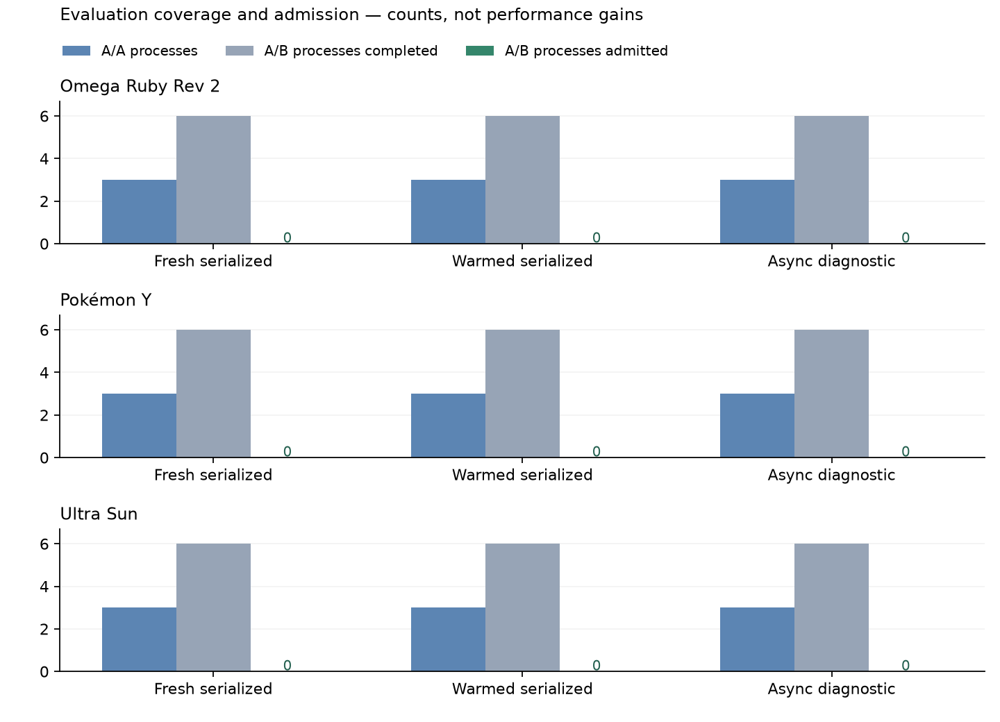

# Original/current three-game evaluation

This evaluates the original runtime against the current PR runtime with the same original native library for each title. It separates startup-inclusive observations, the named route window, application-cache state and asynchronous scheduling. **Timing admission is reported separately from completed execution.**

## Protocol and coverage

| Title | Fresh serialized | Warmed serialized | Async diagnostic |
|---|---|---|---|
| Omega Ruby Rev 2 | 3 A/A + 3 pairs; held | 3 A/A + 3 pairs; held | 3 A/A + 3 pairs; held |
| Pokémon Y | 3 A/A + 3 pairs; held | 3 A/A + 3 pairs; held | 3 A/A + 3 pairs; held |
| Ultra Sun | 3 A/A + 3 pairs; held | 3 A/A + 3 pairs; held | 3 A/A + 3 pairs; held |

The fixed campaign completed **87 native processes**: 27 A/A controls, 54 A/B executions (27 pairs), and six per-build cache preparations. Every run used 6,000 batches, native 1× quality, zero frame skips, its title-specific input/save/clock and the same original native DSO on both sides. The measured route window is `[1800, 6000)`; startup still executes and is retained in whole-process metrics.

The serialized correctness validation separately completed one original/current pair per title with eight matching images, literal warning/work fields and 20 matching guest-trace checkpoints. Three async validation pairs also completed, but their state/output differences remain diagnostic. The timing campaign does not add guest traces to its measured workloads.

## Admission and interpretation

All six serialized series matched captured work, output, warnings and renderer across original/current repetitions; their named-window guest work also matched. **None passed every timing-admission gate.** Background load, SMT activity and A/A spread remain material limits. Y’s fresh-cache A/A timing spread passed its budget, but its host observations did not. Ultra Sun’s fresh serialized A/B runs passed the 10% aggregate external-CPU check, but other gates still held that series.

All three async series differed in captured work/output and window work. They remain a separate scheduling diagnostic, not an equal-work speed comparison. Exact per-series reasons and A/A spreads are in the compact provenance JSON.

A completed replay is not an admitted performance gain. Rejected preflights, A/A spread, during-run thermal/SMT activity and external-host CPU remain in every series decision. No trial was removed, replaced or retried for a favorable score. Hardware: AMD Ryzen 9 7940HS w/ Radeon 780M Graphics and NVIDIA RTX 4060 Laptop / GLES 3.2 (615.78.08). The prospectively fixed formal host budget is 10%; the separate 3% diagnostic is stricter, not a percentage error bar. Affinity observes four physical cores and their SMT siblings; it does not isolate desktop work or fix boost clocks. Local CPU-temperature ceiling was fixed at 97°C before this campaign, with a 3°C preflight stability span. This is a host-specific diagnostic policy, not a handheld temperature recommendation.

Raw CPU/wall/RSS values, simultaneous RssAnon/RssFile/RssShmem observations, faults/I/O, batch quantiles, GPU-queue waits, per-process pair ratios, one-second host readings and all failed prototypes are retained locally. Held timing series produce no speedup or memory-saving chart. This figure reports coverage/admission counts only.

## Revised desktop policy

The earlier limits were introduced by this PR's evaluation tooling, not required
by the repository owner. The [revised example](consistent-evals.md#practical-desktop-limits)
allows 10% aggregate preflight activity, 15% unrelated CPU during execution, 25%
selected-core/SMT activity, 10% A/A timing spread and a 5°C preflight temperature
change. Temperature ceilings and work/output/integrity checks remain unchanged.

A retrospective check of all 81 A/A and A/B observations found 61 preflight
passes under these limits; 47 passed the during-run observations and 74 the
external-CPU budget. No complete series passed every revised timing screen.
These counts overlap and must not be added. No process was rerun, dropped or
replaced. The original campaign and its held verdicts remain unchanged; this is
policy sensitivity, not a new admitted performance result. See the
[compact sensitivity record](assets/consistent-eval-policy-sensitivity.json).
The revised policy is ready to freeze into future campaigns.

## Source and validation

- Original code: `178f2b0`; current performance code: `e628789`. Each has the same frontend observer/reporting implementation. Only the two frontend observer files differ from those respective source parents; engine/compiler/lockfile hashes are verified. Original preparation is reproducible with `prepare_baseline.py`.
- Runtime SHA-256: original `5d8d373e…`; current `939d9225…`.
- See [compact portable provenance](assets/consistent-eval-provenance.json) for original DSO identities, observer hashes, protocol, equality checks and every admission reason. No private path, ROM, save, generated game source/library, game image, raw trace or environment dump is published.
- This observer/tooling update: 18 frontend release tests and AArch64 Linux check / ARM64 Android release link passed. 50 Python tests and focused static checks passed. Earlier engine-suite results belong to their documented source freezes; the full GPU suite was not rerun for observer-only changes.
- The later policy-only update passed all 55 Python tests and focused static/format/whitespace checks. Runtime sources and executables did not change; no game or ARM build was rerun for the policy update.

The prototype caught a real observer error: the existing status logger resets its GPU-wait counter. The final observer records reset-aware per-batch deltas and has a regression bound to that reset contract. Older cumulative-counter CSV headers are rejected. All failed receipts remain local.

## Next telemetry questions

Use the new named windows to choose where to profile next: separate load/shader-cache costs from sustained route CPU, inspect host GPU-queue waits in the async lane, and acquire independent battle-entry/transition fixtures before changing cache lifetime or scheduling policy. These are research directions, not promised optimizations. No new native SDK replacement or renderer bridge is introduced here.

Route loops include long idle intervals. These results do not establish battle coverage, full game-state/audio equivalence, real presentation frame pacing, handheld performance, power savings or total-device RAM. Human visual review and real Android/KMS/Mali testing remain outstanding.

[Protocol and reproduction](consistent-evals.md) · [Earlier incremental runtime decisions](native-boundary-results.md)
