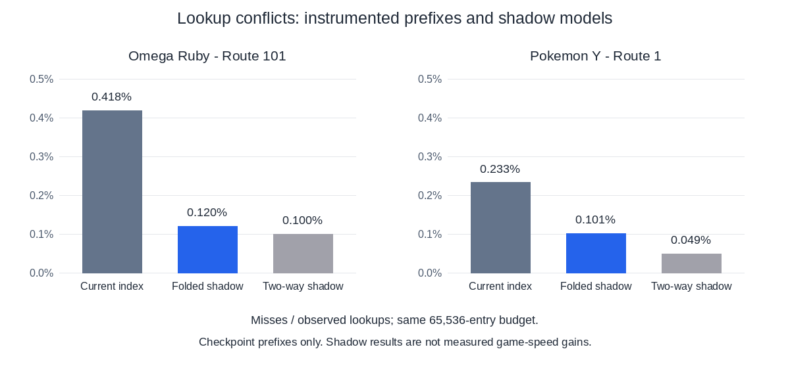

# Omega Ruby and Y early-route follow-up

Saved, player-controlled checkpoints now let these titles exercise ordinary
outdoor work. This follow-up retains two small changes: format-specialized
uniform conversion and a better-distributed index for the existing native
lookup cache. **No game-level speedup or memory reduction is established.**
The previous 2× objective was not resumed.

## Three independent decisions

| Candidate | Evidence and disposition |
|---|---|
| Passive first-word PICA write fast path | Exact scalar-reference tests and game replays passed. About half the observed packet prefix qualified, but an extra branch and duplicated store logic lacked an admitted practical benefit. **Fast-path code rejected.** The new single-word packet regression test fills a previous coverage gap and stays. |
| Uniform conversion specialized by format | **Retained as a small structural optimization.** The burst loop passes its known 24/32-bit format through conversion. Release x86_64 assembly removes the shared per-vector finishing call on the wide path; the packed path still calls a helper. Per-vector trace checks, NaN payloads, cursor/staging behavior and out-of-range writes remain covered by the independent scalar reference. No logging check is hoisted across a burst. |
| Native lookup-cache conflicts | **Retained as a small same-capacity index change.** Fold higher address bits into the index: `key = address >> 1; index = (key ^ (key >> 16)) & 65535`. Full address tags, cached negative results and placement invalidation remain unchanged. Shadow replay predicts fewer conflicts on both observed address streams. This does not establish faster games. A two-way cache was modeled only; it was not promoted. |

The lookup test uses distinct authored function bodies and addresses that
still collide under the new index, covering ARM/Thumb tags, negative results,
eviction and cache reset. No additional cache, capacity, counter or diagnostic
state enters production.

## Workloads and comparison protocol

| Title | Scene | Protocol and repetitions |
|---|---|---|
| Omega Ruby USA Rev 2 | Route 101 southern clear path, Torchic, after Birch rescue | 6,000 frames; three PR-control and three candidate trials for each candidate, fixed control/candidate/candidate/control/control/candidate order. |
| Pokémon Y USA | Route 1 northern clear path, Fennekin, after Shauna battle | Same counts and order, using its own save and input. |

All **36 independent comparison runs** completed equal work, with identical
guest instruction counts, picture/report fields, warning sections, complete
300-frame-interval guest traces, and all eight captured BMP hashes within each
title. The control is the existing PR at `138a932`, **not** original revision
`178f2b0`. Each candidate changes only one area relative to that PR control.
Both sides always use the **same original title native library**, compiled from
`178f2b0`; no generated-code or PGO change contributes to these comparisons.

Release builds use the same locked/offline command, thin LTO and four codegen
units. Each trial has a fresh process/application cache and identical private
save/font/format bytes. Host page cache is uncontrolled. Clock is fixed at
4,000,000,000,000 ms since 1900; resolution is native 1×, GPU execution is
serialized, frameskip/generic shaders/stand-ins are off, and title options are
unchanged. Y keeps its realtime-GPU profile. Omega keeps outlines and its
original battle-screen settings. Actual renderer is NVIDIA RTX 4060 Laptop
GPU, GLES 3.2 / 615.78.08. Startup remains included in process observations.

These are short clear-path loops with long idle intervals, not battle,
interior, grass or broad scene-transition coverage. Omega's first captured
frame is still boot fade; subsequent captures show Route 101. The title-specific
[input and scene receipts](../tools/perf/workloads/omega-ruby-usa-route101.json)
and [Y receipt](../tools/perf/workloads/pokemon-y-usa-route1.json) record that
limit. No Ultra Sun scene approval was borrowed.

### Timing admission

Every comparison failed the prospective **10% external-CPU gate**. The stricter
3% diagnostic also failed; no gate was relaxed and no trial was excluded or
replaced. Maximum observed external CPU, across each six-trial comparison:

| Candidate | Omega Ruby | Y |
|---|---:|---:|
| Passive first word | 12.11% | 13.57% |
| Uniform format | 22.73% | 17.09% |
| Folded lookup index | 25.13% | 13.66% |

No CPU/time/RSS improvement chart is drawn from those ineligible observations.
Raw process measurements, simultaneous RssAnon/RssFile/RssShmem snapshots,
fault/I/O counters, failed setup attempts and full build/run receipts remain
local. File-backed RSS is reclaimable and is not physical/system/GPU memory,
SD-card traffic or battery savings.

### Cache diagnostic, separate from timing

A private instrumented build counted compulsory and replacement misses by
active module and simulated folded and two-way indices on the same lookup
sequence. Its game output/trace matches the uninstrumented control. The counters
were written periodically: **these are cumulative prefixes through the last
1,048,576-call checkpoint, not complete-run totals**. The final tail is absent.
Module placement resets cache tags and compulsory-address history. Code outside
known active module ranges is labeled `main-or-unmapped`, not proven main code.
The packet diagnostic likewise stops at its last 65,536-packet checkpoint.

[Small diagnostic counts, including per-module populations](assets/multititle-lookup-observations.json)
retain the denominators. Both shadow designs have 65,536 entries; the two-way
model has 32,768 two-entry LRU sets. Lower modeled misses are not measured
avoidable time or predicted FPS. Instrumentation and its allocation/sampling
cost are excluded from every ordinary comparison and from the PR source.

## Reproduction and playtest limits

Use `tools/perf/evaluate.py run` with the relevant `.input`/`.json` workload,
your own matching ROM and original native library, and a private checkpoint
matching the documented scene/save hash. Use three trials for both versions,
the same implementation profile and the existing fixed input/clock/quality
settings; interleave the six runs as above before comparing their receipts.
Saves and game assets are not distributed. Golden hashes describe this frozen
renderer/workload, not universal output across drivers or other saves.

The local Original and Optimized setups have separate persistent saves.
Opening battles were reached in Original; unusually solid black shadows in
Omega and an absent opponent-name HUD label in Y were already visible there.
Those are baseline observations, not proven PR regressions. Short outdoor
checks do not certify full-game visuals/audio, and physical handheld/controller
validation and user visual signoff remain outstanding. Ultra Moon gameplay
was not tested. No ROM, generated C/library, save, key, game image or raw profile
is included in this change.

## Final retained-source validation

The final combination passed **421 release workspace tests** (eight explicit
ignores), including all three focused regression names and the actual GLES
pipeline fixture. The AArch64 Linux release workspace check passed; the Android
release library linked and its Cargo-discovered ELF was verified as AArch64.
These are compilation/link checks, not ARM execution.

One final 6,000-frame combination replay per new title matched its frozen
control exactly. A fresh control/final 6,000-frame Ultra Sun Route 1 pair also
matched work, warnings, eight images and the complete guest trace. These are
functional regressions, not additional timed repetitions. An outer/inner log
filename collision stopped the first final-replay wrapper before any game
launched; its receipt is preserved with the corrected run.

[Compact source, binary, native-library and result provenance](assets/multititle-route-provenance.json)
binds the final source bytes and all independent candidates without publishing
private paths or raw logs.

The local Y/Omega optimized launcher was refreshed to a versioned binary built
from these accepted source bytes. Normal desktop Continue, movement and menu
checks passed in both titles on NVIDIA GLES, and both windows exited normally.
Old binaries and saves were preserved. Original and Ultra Sun launchers were
not changed. This manual adapter is outside the timed evaluation.
