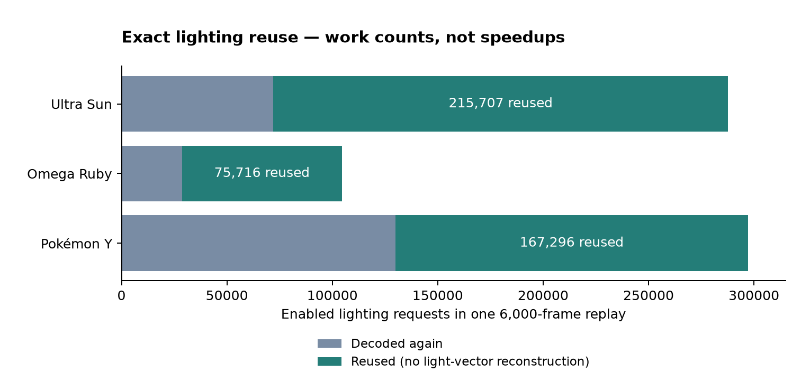

# Native-boundary candidate results

Six requested candidates were assessed independently against the PR's existing runtime at `0b17fbb4`. Lighting reuse and typed service dispatch remove verified repeated construction/ownership work and preserve the recorded outputs. **No game-level speed or RSS improvement is established.**

| Candidate | Decision | Evidence |
| --- | --- | --- |
| 1. Decoded lighting / TEV reuse | Retain lighting only | A complete 106-word raw key feeds the decoder; draws borrow the retained value. Current replay hits: 215,707 / 75,716 / 167,296 in Ultra Sun / Omega Ruby / Y. Hits avoid light-vector reconstruction. TEV is an allocation-free fixed array; no separate TEV cache is promoted without an exclusive-cost case. |
| 2. Partial color readback | Exclude prototype | Across 18,000 frames, only one readback qualified, during Ultra Sun startup: 512 KiB could shrink to 128 KiB. None qualified in the other titles. Authored GL and encoder fixtures were exercised privately; no recurring gameplay benefit established. |
| 3. Typed HLE dispatch | Retain | Resolve handler identity once per object; static known aliases/shared unknown names eliminate the two per-request String clones. 117,586 / 94,930 / 132,826 IPC requests were observed. Service work, subhandles, errors, TLS replies and conditional scheduling remain unchanged. |
| 4. Native integer helpers | Stop at cost/contract gate | Matching division/remainder-like routines were identified across the three games. Historical IP populations are small, while flags, stack, exception and mid-budget behavior remain significant obligations. No native override tested or promoted. |
| 5. Native SDK request wrappers | Hold | All 593 current IPC site records mapped to original entries. Dominant GSP submit wrappers have 10 instructions. Frequency does not establish removable marshalling cost; the true SVC continuation/yield must remain. No replacement promoted. |
| 6. Native graphics producers | Hold | Current GSP lists resolve to shared ring enqueuers, not the PICA command producers. Narrow descriptor wrappers and their direct parents were identified, but their original producer identity/exclusive cost remain unproven. No renderer or guest ABI bridge added. |

Each enabled lighting request snapshots and compares 106 words; a miss still decodes, and one key plus one bounded lighting value remains resident. The retained change removes repeated construction, with its actual CPU tradeoff unresolved by these noisy runs.

The chart counts exact-key reuse in diagnostic replays, excluding disabled lighting. It is neither a timing chart nor a memory-saving estimate. Temporary lookup vectors and allocator-global traffic are outside the counter. Counts differ from older metadata censuses because these measure the actual complete cache key.

## Replays and measurement limits

Independent C1 and C3 each used three 6,000-frame repetitions per title against three control repetitions. C2 had one functional replay per title after its population gate rejected promotion: 30 independent replays altogether. The selected C1 + C3 profile also received one final replay per title. Same original native library, clock, checkpoint, inputs, settings and quality were used within each title; pixels, instruction counts, warnings and all sampled guest-trace checkpoints matched.

Host: x86-64 Linux / NVIDIA RTX 4060 Laptop GLES. Scenes: Ultra Sun Route 1, Omega Ruby Route 101, Pokémon Y Route 1, with startup and long idle periods. No battles/interiors/full-game visual certification or physical RG DS Plus/Android runtime proof.

These process CPU-second ranges are **held observations**, not accepted benchmark gains. All six repeated comparisons exceeded the predefined 10% unrelated-host-CPU gate; all also failed the stricter 3% diagnostic gate. No noisy runs were discarded or retried to obtain a favorable result.

| Title | Control CPU s (3 runs) | Lighting CPU s (3) | Dispatch CPU s (3) | Admission |
| --- | ---: | ---: | ---: | --- |
| Ultra Sun | 16.44–17.69 | 16.26–18.22 | 16.42–18.26 | Held |
| Omega Ruby | 13.42–13.74 | 13.07–13.86 | 13.57–13.97 | Held |
| Pokémon Y | 16.91–17.34 | 16.73–20.98 | 16.84–23.86 | Held |

[Portable aggregate provenance](assets/native-boundary-followup.json) retains wall/CPU/RSS ranges, per-trial simultaneous RssAnon/RssFile/RssShmem snapshots, build hashes and equality decisions. File RSS can be reclaimable; it is not private heap. Component observations are not independent maxima and must not be summed across trials. Per-title ROM-cache/allocator profiles remain fixed within comparisons; page-cache/I/O tradeoffs are not attributed to these changes. Reproduce using the [eval guide](performance-eval.md) and [workloads](../tools/perf/workloads/README.md), with your own matching private checkpoint/ROM/library. Instrumented counts and historical profiles are not admissible timing trials.

## Correctness and review

Lighting tests bind invalidation to every raw register bit, preserve disabled/re-enable behavior, verify retained storage and exercise software draws. Cached/fresh tests share the refactored decoder: they prove cache consistency; source review and original-runtime replays provide the separate preservation checks. Dispatch tests cover aliases, unknown names, subhandles, duplicate/closed/reused handles, invalid requests and unchanged TLS. Existing tests retain service scheduling coverage. Direct Rust construction of public Target/KObject session fields now uses ServiceName; the generated-game DSO ABI is unchanged.

The accepted production changes passed the release workspace suite (432 reported passes, eight explicit ignores), 34 Python evaluation tests, an AArch64 Linux check and ARM64 Android release linking. The two monolithic GL fixtures were explicitly exercised separately from the separable suite. A standalone wrong-mode fixture exposed background compiler activity during process exit; its final test-only cleanup now stops that compiler on both exit paths. Both paths were checked separately after the full-suite run, and the production module prefix is unchanged and hash-bound. This fixture cleanup changes no game behavior.

An independent GPT-6.1 Sol source review found no blocking correctness issue. Its review did not execute tests or establish performance. Final release/cross-target check results are recorded in the PR description. Native-hook reports, rejected patches, raw logs and game captures stay private.

Both retained mechanisms are independently implemented in this MIT project; donor emulator implementations were used as architectural references, not transplanted. Further native replacements require identity, exclusive-cost and observable-behavior proof before implementation.
