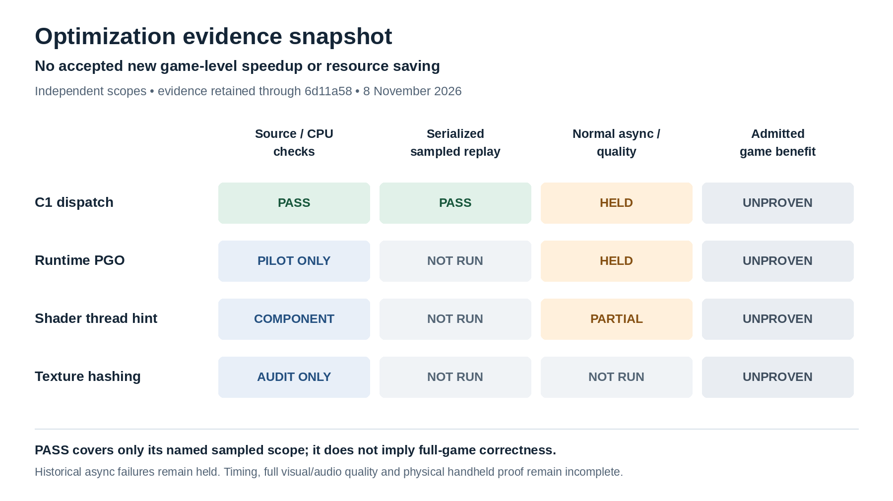
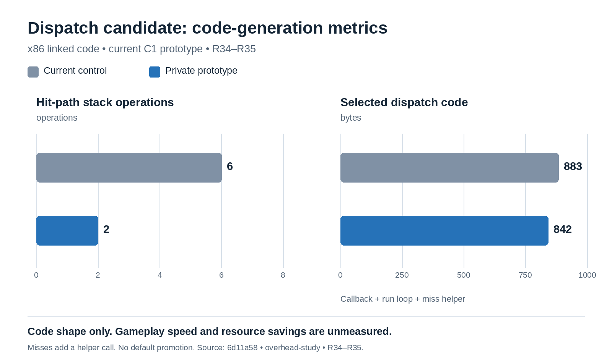

# Optimization results snapshot — 8 November 2026

**No new game-level speedup or resource saving has been accepted.** These figures summarize the evidence retained through source revision [`6d11a58`](https://github.com/Marlos001/pocket-native/blob/6d11a58c9e8ef75415657c8bd1648ee5f388c343/docs/overhead-study-2026-11-07.md). Later experiments require their own results; this is a dated snapshot.

## What has passed, and what remains open



Each column answers a different question. A green cell covers only the named recorded scope; it does not establish complete visual/audio correctness, shipped asynchronous behavior or a measured performance benefit.

- **C1 dispatch:** current CPU semantics, final-linked code shape and a 300-batch Omega Ruby serialized sampled comparison pass. The historical asynchronous comparison remains held. Timing and default promotion remain unaccepted.
- **Runtime PGO:** collection/profile-use plumbing and a game pilot exist, but the asynchronous exact-work comparison remains held. No serialized PGO candidate result or accepted gameplay gain is represented.
- **Shader compiler-thread hint:** the component workload and scoped normal-startup readiness observations exist. A complete paired resource/quality benefit remains unproven; the selector is diagnostic and does not change production defaults.
- **Texture hashing:** the inspected x86 loop already unrolls its four lanes. The proposed missing-unroll mechanism was disproved for that binary; no material removable cost or justified rewrite is established.

The unchanged asynchronous baseline itself has failed exact-work repeatability. The current serialized control is repeatable within its sampled scope. These findings explain why the modes have separate admission rules; they do not clear old failed candidates or justify a tolerance change.

## Dispatch prototype: smaller code, performance still unmeasured



| Final-linked x86 metric | Current control | Private C1 prototype |
| --- | ---: | ---: |
| Hit-path stack operations | 6 | 2 |
| Selected dispatch symbol bytes | 883 | 842 |

The byte population contains the callback, run loop and sole miss helper. It is not the entire executable. Moving miss handling to a helper removes hit-path stack work while adding a helper call on misses. Dynamic miss frequency, CPU savings and game speed remain unmeasured. These bars are **code-generation proxies, not FPS, latency or memory measurements**. The private prototype is not promoted or enabled by default.

The current serialized comparison matched all recorded work counters, eight image hashes, guest-trace bytes, owner/causal documents and generated settings, with both native/evaluator exits zero and clean cleanup. This covers that short replay only; normal audio, transitions, full-game coverage and physical RG DS Plus behavior are not established.

## Reproduction and boundaries

The portable [graph data](assets/optimization-results-2026-11-08.json) records values, scope and the pinned public source document. Regenerate the PNGs with:

```sh
python tools/perf/render_public_results.py
```

The renderer needs Pillow and fontconfig (`fc-match`) and performs no game, compilation or benchmark execution. Source evidence is in the pinned study's **R29–R33**, **R34–R35**, **runtime PGO pilot**, and **R36–R37** sections. Raw private game artifacts are not required to read these summaries and are not published.

Single-process shader resource observations and ineligible timing ratios are deliberately omitted from benefit graphs. The 170 closed timing executions and 15 held series remain unchanged. Full visual/audio quality, the three-game scale/aspect/layout matrix, physical handheld performance, power and total-device RAM remain unproven.
