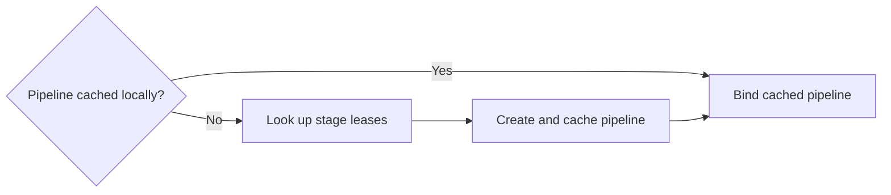

# Bounded Route 1 follow-up

A saved Route 1 checkpoint makes outdoor gameplay repeatable without replaying
the full prologue. Of four candidates tested independently, this follow-up
retains only the cached-pipeline binding shortcut. **No gameplay speedup is
claimed.** The earlier 2× objective was not resumed.

## What changes

A cached separable pipeline already has its stage ownership secured by the
live program pair. Binding it now checks the GL thread's local pipeline cache
first, avoiding the global stage-map lock and temporary Arc clones on a hit.
A miss follows the existing stage lookup and pipeline creation path. Monolithic
fallback, deletion, stage leases and context-local ownership stay intact.

The actual GLES fixture switches repeatedly between red and blue programs,
checks exact pixels, then deletes and recreates a pair. Its first 17 binds
perform two global pair lookups instead of 17. This proves removed operations
in an authored fixture, **not a measured game-level speedup**.

## Four independent dispositions

| Candidate | Checks and decision |
|---|---|
| ROM-cache budgets 4 / off / 16 / 64 MiB | Three runs each, all exact. Larger budgets reduced fault/I/O counters while retaining more file-backed memory. Timing was ineligible; no profile/default/launcher setting changed. |
| Local pipeline hit before global lookup | Three candidate and three paired control runs, all exact. Retained as a small overhead-removal simplification, without a demonstrated gameplay speedup. |
| Deadline-gated texture expiration | Three candidate and three paired control runs, all exact. Boundary/alias tests passed; 1,801 fixture batches needed five expiration passes, with unchanged deadlines and per-batch dead-alias pruning. Not retained: no admitted gameplay benefit justified the additional scheduling state. |
| Compact SIMD math replacement | Static object/link checks and 1,769 inherited, 544 directed FP, 20 boundary and 10 finite trap-enabled linked-entry cases passed. Three native-control/candidate runs each were exact. No useful admitted gameplay benefit; private replacement and generator changes were not promoted. |

The phase-gated diagnostic samples frames 1,500–5,999. The selected math routine
accounted for 84 of 10,014 IP samples. Sampling is partial attribution, not an
avoidable-cost or speedup measurement; the offline symbolizer left some other
addresses unresolved. The isolated routine's earlier microbenchmark is not
projected onto game performance.

## Protocol and limits

All 30 comparison runs completed 6,000 frames with matching guest instruction
counts, picture/work fields, literal warning sections and all eight actual BMP
hashes. The [input and scene receipt](../tools/perf/workloads/ultra-sun-usa-route1.json)
cover Route 1 navigation and the house exterior, not battles or interiors.
Each trial starts from identical private save/font/format bytes, a fresh process
and fresh application caches. Host page cache is uncontrolled. Clock is fixed
at 4,000,000,000,000 ms since 1900; resolution is native 1×, GPU execution is
serialized, and frameskip, generic shaders and approximate stand-ins are off.
Startup remains included in process CPU/wall/RSS observations.

The prospective host-activity gate is 10%, with 3% retained as a stricter
diagnostic. Every candidate comparison failed timing admission; no trial was
excluded or replaced, and no timing gate was relaxed. Raw times and simultaneous
RSS components remain local. Reclaimable file RSS and fault/I/O differences do
not establish physical-memory, SD-card, battery or handheld improvements.

Cache and renderer trials use the same original native library on both sides.
Renderer control and candidates use the same build command/flags, with each
candidate tested alone. The math experiment separately compares its unchanged
PGO native-library base against a protected f109-only replacement, using one
identical runtime; it supplies no public-runtime attribution. Exact frozen
identities are in the [small provenance receipt](assets/ultra-sun-route1-provenance.json).

All ordinary comparison runs used NVIDIA RTX 4060 GLES. An initial separate
profiling wrapper selected software GL; it was stopped, retained as held and
excluded. Its corrected hardware-rendered diagnostic is separate from timing.
The new pipeline fixture initially passed its assertions but crashed at process
exit with background prewarm still inside the driver. It now drains prewarm
before exit and passed as a complete process. All failed attempts remain local.

The verified Original/Optimized desktop launchers, binaries and persistent saves
remain unchanged. They do not contain this follow-up shortcut. Ultra Moon has
no tested ROM/checkpoint in this evaluation; shared profiles are not gameplay
validation. No ROM, generated game code/library, save, key, shader cache or game
image is included.

Final retained-source validation passed: **420 release workspace tests**
(eight explicit ignores), **48 Python tests**, the new actual-GLES separable
fixture and its deliberately unavailable-EGL case, AArch64 Linux workspace
check, and Android release link with its Cargo-discovered AArch64 ELF verified.
An initial Android validation wrapper omitted the NDK linker settings; its
host-linker failure is retained separately from the corrected passing build.
No ARM execution is implied. These tests and short replays do not constitute
complete visual/audio certification or user signoff.
