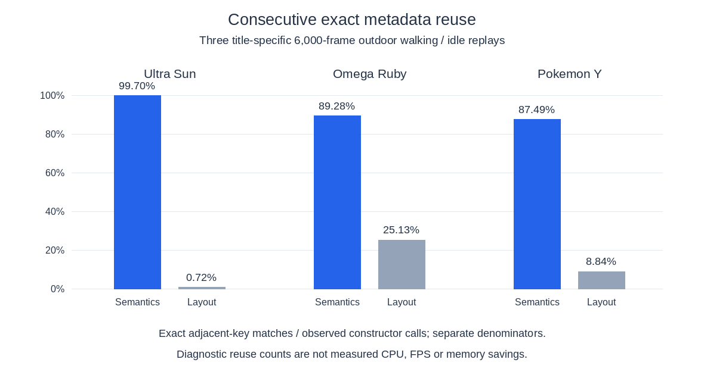
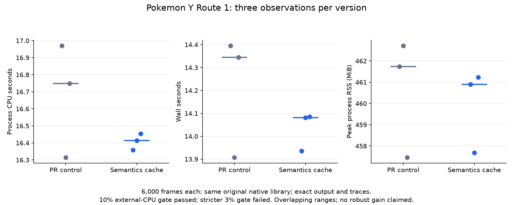

# Three-game reuse follow-up

The three-game research round tested whether larger repeated work could be
removed beyond the previous small changes. The retained result is deliberately
small: reuse exact output-semantic metadata and borrow surface-upload rows.
No game-level speedup, memory reduction or handheld result is established.

## Retained source

The output-semantics cache keeps one exact nine-word register key and the
24-word result. Any key mismatch calls the unchanged reader. It is populated
only at the existing hardware-shading call site; early-return and software
paths retain their previous behavior. Full raw-bit equality avoids invalidation
versions, wraparound and stale hash hits. Tests cover default state, every key
dependency, ignored bits, replacement, output masks, early returns and changes
to every register against a fresh reader.

Surface uploads already convert rows into a staging buffer. The GL call now
borrows its contiguous range instead of allocating and copying that range
again. The staging allocation remains alive until client-memory upload returns.
An independent old-range reference and actual GLES tests cover partial rows,
five color formats and three depth formats, with tiled/linear layouts.

## Diagnostic evidence, separate from speed

A private behavior-neutral observer ran 6,000 frames in each existing outdoor
checkpoint. A fresh uninstrumented control matched work, full guest traces,
literal warning sections and all eight sampled images. A headset changed the
input-device warning after the initial controls; that comparison remains held.
Fresh controls established the full comparison without filtering warnings.

These are constructor-call denominators, not frame rates or savings. Walking
input pulses and idle intervals were separated in 300-call frame bins; a bin
can contain both. These scenes omit battles, interiors and broad transitions.
The bounded 48 MiB observer evicted many keys, so low observed command-list
recurrence does not prove that no larger population repeats. Partial entry keys
also omit mutable state and resource generations; repeated bytes never
constitute permission to replay draws.

## Independent decisions

| Candidate | Test and decision |
|---|---|
| Exact output semantics | Focused cache/reference tests and independent three-title comparisons. Retained as a bounded structural optimization; no measured game gain. |
| Borrow upload staging rows | Scalar-range and actual GLES partial-upload tests, plus independent three-title comparisons. Retained as a small copy removal; observed extra copies were only 2.3–3.6 MiB per 6,000 frames. |
| Full vertex-layout cache | Consecutive full-key reuse was 0.72% / 25.13% / 8.84% (Ultra Sun / Omega / Y). Most calls would still construct and add cache/Arc work. Not implemented; no universal performance rejection is claimed. |
| Command-list translation replay | Complete input-byte and partial-entry recurrence census, with packet weighting. Safe replay still needs a complete entry/resource key; high eviction limits the population measurement. Deferred, not a negative speed result. |
| Lazy picture hashing | Fixed 256 KiB read-time transcript; eager fallback; six independent eager-reference tests and a separate runtime comparison. Not retained: the admitted Y comparison has overlapping ranges, negligible median CPU change and no convincing benefit to justify the transcript/copy cost. Both intermediate and final bottom-screen hash observations remain required. |
| Exact dirty tracking | Revalidation-reason and hashed-byte census plus write-path audit. Journal trust does not prove complete generated-fastmem/DMA/GPU write coverage. No safety rehash removed or trust window extended. |
| Adjacent draw fusion | Complete six-gate held-draw observer, exact replays: eligible pairs 0 / 63 / 0 across 329,379 / 159,794 / 402,215 draws. No fusion implementation justified for this subset. |
| Guest-register/copy promotion | Distinct private OR and Y copy prototypes each passed 72,352 original-machine differential cases, including budgets, resume labels and aliases. No game timing or generic compiler pass; no generated game code/library published. Prior broader register-local failures remain relevant. |
| Guarded indirect calls | Authored model passed 1,615 cases and detected four broken variants. A four-site private OR/Y census also found one repeated raw main-code target per selected site (zero overflow), with exact game replays. This is a selected-site observation without placement generations, not whole-game or implementation proof. A private exact-main-target direct guard then passed 36,288 authored ABI cases per title and 12 exact game comparisons using matched original compiler flags. Both title groups passed the formal 10% external-CPU gate; the stricter 3% diagnostic failed. The observations established no gain (Omega approximately unchanged; Y observed medians worse). Guard rejected; no public compiler change and no runtime-only attribution from changing native libraries. |
| Copy/fill intrinsics and AAC workers | Source-bound counterexamples reject naive substitutions and early asynchronous reply. Proper guarded/scheduled designs remain unimplemented and unmeasured. |
| Deterministic/default async GPU | Three current-control normal-mode diagnostics per title completed, but guest traces varied. Descriptive busy/wait logs do not justify changing interrupt timing or comparing async time against serialized controls. |

## Runtime comparison and validation

All **54 independent comparison runs** (three control and three candidate per
title per candidate, fixed C/X/X/C/C/X order) completed equal work and matched
eight sampled images, warnings and complete 300-frame guest traces. Seven of
nine comparisons failed the prospective 10% host-noise admission gate.
Semantics/Y and lazy-hashing/Y passed that gate; **all nine** failed the stricter
3% diagnostic. No trial was removed or replaced.

For the retained semantics cache in Y, CPU seconds were 16.748 median
(16.315–16.971) versus 16.414 (16.358–16.454); wall seconds were 14.344
(13.908–14.396) versus 14.081 (13.936–14.086). Peak process RSS was
461.73 MiB (457.46–462.72) versus 460.90 MiB (457.68–461.24).
These small three-trial observed ranges overlap. The roughly 2% CPU-median
difference does not establish a robust game-level gain; the conservative
observed maximum-candidate/minimum-control CPU ratio is 1.0085.

Lazy hashing's admitted Y observation was 16.896 versus 16.832 CPU seconds
and 14.368 versus 14.469 wall seconds, with overlapping ranges. Its
256 KiB transcript, snapshot traffic and added state were not justified.
No performance chart uses any of the seven timing-ineligible comparisons.

Every runtime candidate changes only its own area against PR control
`09539fe`, with the same original `178f2b0` native library on both sides within
each title. This is not an original-revision-versus-final comparison.
Use the existing title-specific input/checkpoint receipts, fixed clock,
native 1x quality, serialized GPU, disabled generic shaders/stand-ins and
fresh per-trial data/cache directories. Host page cache is uncontrolled.
NVIDIA RTX 4060 / GLES 3.2 is desktop evidence only.

The prospective 10% external-CPU admission gate and stricter 3% diagnostic
remain separate. They are noise limits, not requested optimization sizes.
No trial is excluded or replaced for a faster result. RssAnon/RssFile/RssShmem
snapshots and fault/I/O counters remain local; no sum of component maxima,
physical-memory or energy saving is inferred.

The retained combination passed **426 locked/offline release workspace tests**
(eight explicit ignores). All five new regressions executed. The AArch64 Linux
workspace check passed; Android release linking passed and its Cargo-discovered
ELF was verified as AArch64. These are build checks, not ARM execution.

One final 6,000-frame retained-combination replay in each title matched its
fresh control exactly: work, warnings, eight sampled images and the complete
guest trace. These are functional regressions, not new timed repetitions.
The explicit final upload fixture logged NVIDIA RTX 4060 / GLES 3.2 and passed.

[Compact provenance and diagnostic counts](assets/three-game-reuse-provenance.json)
retain source/binary identities and all dispositions. Raw/held/rejected
receipts, original artifacts and private saves remain local. No ROM, generated
game C/library, save, key, game image or raw profile is included. Human visual
review, complete game coverage and actual ARM/Mali/handheld execution remain
outstanding.
