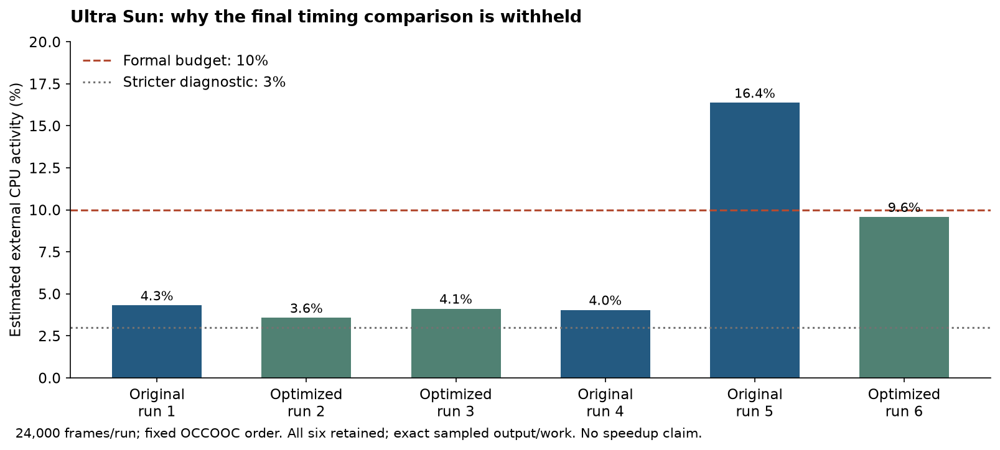

# Host evaluation and contribution results

This work targets converted-game CPU time and memory while retaining fixed
render quality and exact sampled output. The requested 2× speed and half-resource
target is **not established**. No RG DS Plus runtime, battery or FPS measurement
is available. See the [reproduction guide](performance-eval.md) and
[hardware/deployment limits](rg-ds-plus-feasibility.md).

The later [Route 1 follow-up](route1-eval-results.md) tests four additional
candidates independently and retains only a small cached-pipeline shortcut.
It does not establish a game-level speedup.

## Retained changes

- Avoid repeated PICA fingerprint scans and use the existing integer-key Fx
  hasher for the bounded decoded-program cache. Preserve invalidation and leases.
- Reuse prepared GLSL on synchronous linking, scan helper call names once and
  copy retained source slices once. Structural mismatches retain the complete
  unelided shader and emit one warning. An independent test reference verifies
  byte equality and malformed-input behavior.
- Batch passive command/uniform writes, compact draw bookkeeping, retain ETC1A4
  compressed layouts where supported, and validate texture aliases and queued
  resource leases.
- Share immutable file-read payloads and copy ROM bytes directly into guest
  memory. The ROM-page retirement policy is opt-in and best effort.
- Keep periodic shader retirement **off by default** and restore background
  fallback preparation. The final tested profile does not enable aggressive
  retirement. Batches are work units, not a fixed number of seconds.
- Skip unnecessary FZ/DN normalization for normal values and integer-to-float
  conversions. Synthetic generated-C/state oracles validate this independently;
  a benchmark using the original native library does not exercise new codegen.
- Fail differential verification on mismatches and cover present or swapped
  private guest pages through checked pagemap flags; no PFN access is required.

## Final controlled host comparison

**The final timing comparison is ineligible.** All six runs completed and
matched exact report/work fields, literal warnings and eight sampled BMPs.
Original run 5 had estimated external CPU activity **16.37%**, exceeding the
prospectively fixed **10%** budget. The stricter **3%** diagnostic also failed.
No trial was excluded, replaced or relabeled, and no speedup is claimed.

The following are **raw diagnostic observations**, median (observed range),
not an accepted performance comparison or confidence interval:

| Metric, 24,000 frames per run | Original, 3 runs | Optimized profile, 3 runs |
|---|---:|---:|
| CPU seconds | 45.00 (43.44–52.77) | 27.42 (26.89–33.36) |
| Wall seconds | 37.54 (36.30–44.52) | 23.72 (23.24–28.44) |
| `wait4` peak process RSS, MiB | 834.0 (833.5–871.6) | 429.8 (427.6–431.8) |

All six rows, sampled simultaneous RSS components, page faults, block I/O and
host activity are in the small [observation CSV](assets/ultra-sun-runtime-observations.csv).
[Provenance and output hashes](assets/ultra-sun-eval-provenance.json) bind the
ROM identity, input, renderer, original/candidate binaries and source archive.
The requested 2× speed / half-resource result is not established; even the
unadmitted observed RSS ranges do not satisfy the conservative half-RSS gate.
There is no accepted CPU/time/RSS improvement chart to publish.

Genuine same-frame Original/Optimized captures were inspected and retained
locally for manual review. **No game imagery is included in this contribution**,
consistent with the project's bring-your-own-game policy. All eight BMP hashes
match across the six runs. Sampled equality does not rule out other glitches,
and agent inspection is not user/human visual signoff.

The final comparison keeps the **same original converted library** on both
sides (`3aa528474512976b143b1a06ed83eda44a18058d5c00960aea60c36378d1a5a8`).
It covers Ultra Sun USA's scripted prologue and player-controlled bedroom,
24,000 frames, fixed clock/input, native 1× rendering, no frameskip/generic
shaders/approximate stand-ins, serialized GPU and fresh per-trial homes and application caches.
The host page cache is uncontrolled and ROM hashing warms file pages.

Original is revision `178f2b0` plus probe instrumentation, runtime hash
`e09c0841…`; the frozen candidate is `c15e1adf…`, built from the pre-Route-1-follow-up public code
with Rust 1.99.1, generic x86_64 release, thin LTO and four codegen units.
No Rust PGO or private native replacements are used. The later cached-pipeline
shortcut was not present in this historical comparison; its Route 1 checks are
reported separately. Final documentation and
portable button fixtures were added after the code/build freeze. Full hashes
are retained in the linked provenance file.

| Declared implementation choice | Original | Optimized |
|---|---|---|
| Shader linking | Monolithic | Separable |
| Background compilation | Enabled | Disabled; synchronous |
| Generic fallback startup preparation | Eight combinations | Eight combinations |
| Periodic linked-program retirement | Absent | Off; no opt-in switch |
| Decoded texture budget | Original default | 16 MiB |
| Initial mutable rings | Original default | 1 MiB, grow as needed |
| ROM page-retirement budget | Original/default off | Explicit 4 MiB, best effort |
| Allocator | System | Host jemalloc preload |

The jemalloc declaration is
`background_thread:true,narenas:2,dirty_decay_ms:100,muzzy_decay_ms:0,retain:false,thp:never`;
its exact library hash is captured locally. Both runs serialize the GPU and
keep generic shaders, generic lighting and approximate stand-ins disabled.
These are combined runtime/profile observations, not per-feature gains.
The cache policy can lower reclaimable file RSS while increasing I/O.
The Optimized runs recorded 223 major faults each and 627,528–627,592 block-input
operations, versus Original's 0–13 major faults and 0–1,816 block-input operations.
These Linux resource counters are not an SD-card throughput/power measurement.
The ROM policy remains opt-in/default-off, with its I/O trade-off explicit. Report
anonymous/file/shared observations separately; they exclude GPU/OS memory.
The public 10% host-activity gate and stricter 3% diagnostic gate are separate.
All attempts are retained; no slower original or best candidate is selected.

Earlier mixed-library results used a separately prepared GCC PGO/RELR library,
not default output of the public converter. They are excluded from this PR's
runtime performance claims. No ROM, generated game C, library, profile data,
save file or raw capture dataset is included.

## Four independent experiments

| Candidate | Evidence and disposition |
|---|---|
| Reuse the PICA decode fingerprint | Retained: cache/state tests, GPU suite and one exact 24k replay. Removes one 4,224-word scan per decode miss; no statistically demonstrated game gain. |
| FxHashMap for `decoded_before` only | Retained with the existing 1.1 dependency: same correctness gates. No change to fingerprint bytes/cache policy and no demonstrated process gain. |
| rustc-hash 2.1.3 alone | Functional GPU/GL/source-corpus/Android-check and exact replay passed. Rejected for this PR: no established benefit justified broader live-hash/iteration changes. The original dependency is retained. |
| Mesa 26.2.6 Panfrost fix | Exact isolated source-patch check passed. G52-capable driver housekeeping, with no identified game benefit or real-device result; no driver change promoted. |

The variants were tested independently before the two retained changes were
combined. One-shot timings with failed diagnostic noise gates are not claimed
as speed improvements. Held preflights, lock-admission failures, rejected code
and raw receipts remain local; none was rewritten into a passing trial.

## Validation and limits

- Final locked/offline release workspace build and **419 tests passed**, with
  eight explicitly ignored local-resource fixtures. All 20 required verifier,
  cache, fallback, policy and liveness test names actually executed.
- The explicit no-binary-cache path, static helper and literal-false feature
  elision color/depth checks, **818 source comparisons / 410 distinct raw
  sources**, and the captured-state wrapper fixture passed separately on the
  recorded NVIDIA GLES driver. The normal suite's opt-in skip was not counted
  as that explicit execution.
- **48 Python tests passed**, including the separate Mali evidence/input tests.
- AArch64 Linux workspace check passed; Android's **release library linked**
  and its actual Cargo-discovered artifact was verified as AArch64 ELF. These
  are build gates, not target execution or Android/handheld gameplay proof.
- Present/swapped pagemap flags, sparse reset, deliberately corrupted generated
  code and generated-C numeric/state oracles passed. No forced-swap execution
  is claimed; unavailable page coverage fails closed.

A final CI-portability follow-up changes only six optional-GLES test setup
branches: they now follow the repository's convention of skipping unavailable
contexts. The affected GPU suite passed **149 tests** on the actual GLES
renderer; all **six forced-unavailable EGL cases** skipped cleanly. The production
source prefix is byte-identical, so benchmark and manual runtime behavior is
unchanged. This follow-up is separate from the earlier full workspace pass.

The first final test attempt held on an ambient governor change. Its functional
continuation exposed a private watchdog ancestry race with a test-owned linker.
Both holds remain local. The next full suite exposed a lifetime fixture observing
raw GL names while startup fallback compilation could allocate/reuse them.
The fixture now drains prewarm before checking deletion; production deletion
and default policy are unchanged. A fresh build, full suite and explicit checks
passed afterward. Later candidates/this fixture change were validated separately
from the earlier independent review.

The final profile also completed one **768 MiB**, four-distinct-core, 400% CPU,
swap-disabled host cgroup attempt: 24,000 frames, exact work/eight images,
**326.63 MiB peak cgroup charge**, and zero recorded OOM events. Literal warnings
differed by the sound-device warning, so this is **partial functional evidence**,
with audio equivalence unknown. The inherited process affinity and required
limits were checked; an undelegated optional effective-cpuset file was absent.
No constrained/unconstrained speed comparison or 512 MiB result is claimed.
Shared file charges can belong to other cgroups, so this is not total physical
RAM, process RSS, GPU memory or a measured handheld application budget. The old
pressure attempt's failed strict admission remains preserved locally.

Separate Original-only Pokémon Y and Omega Ruby traces reached professor dialogue/title
presentation. They establish boot/intro compatibility only, with interpreted
instructions reported; neither establishes player-controlled gameplay.

The independent Kiro/Claude Opus 5.5 review inspected an earlier 53-file snapshot
without running tests. Concrete policy, fallback, liveness, verifier-coverage and
claims findings were addressed; later candidate/adapter changes require their
own checks and are outside that snapshot's automatic coverage. Human review and
manual inspection remain required. The local desktop play adapter is a separate,
identical window/input layer for both builds, not part of benchmark timing.

## Reproduce the scene

Use the [evaluation guide](performance-eval.md) and reviewed
[implementation-profile schema](../tools/perf/IMPLEMENTATION_PROFILES.md).
The portable [24k bedroom input](../tools/perf/workloads/ultra-sun-usa-bedroom.input)
and [scene receipt](../tools/perf/workloads/ultra-sun-usa-bedroom.json) contain
buttons/coordinates and hashes only. Use the same original converted library,
fresh font-only seed, clock `4000000000000`, 24,000 frames, resolution 1 and
fixed order Original/Optimized/Optimized/Original/Original/Optimized. Keep all
attempts and enforce the noise/quality/work gates; do not select the slowest
original or fastest candidate. The older 18k fixture is cutscene-only.
